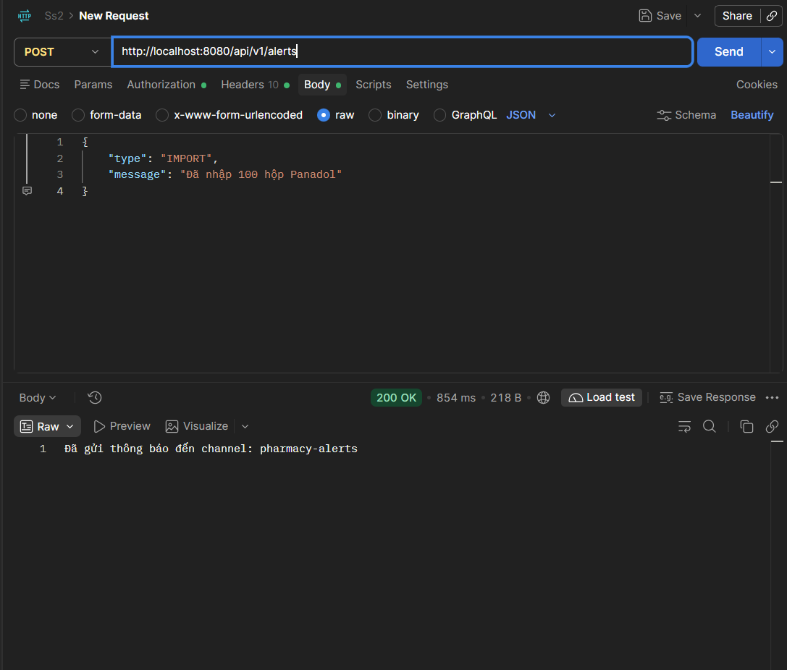
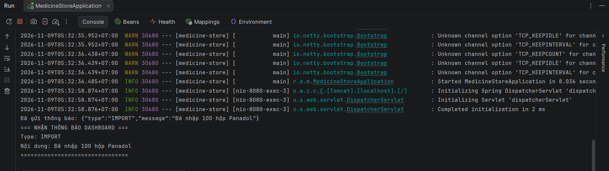

# Minh chứng Redis Pub/Sub

## 1. Kết quả kiểm thử trên Postman

Gửi request `POST` đến API:

`http://localhost:8080/api/v1/alerts`

Nội dung Body:

```json
{
    "type": "IMPORT",
    "message": "Đã nhập 100 hộp Panadol"
}
```

Kết quả trả về từ API: **200 OK**.



## 2. Kết quả nhận thông báo trên Console

Sau khi Publisher gửi message vào channel `pharmacy-alerts`, Subscriber đang lắng nghe channel sẽ nhận được thông báo và in nội dung ra Console.

Kết quả hiển thị:

## 3. Kết luận

Kết quả kiểm thử cho thấy Redis Pub/Sub hoạt động thành công:

- Publisher gửi message JSON vào channel `pharmacy-alerts`.
- Subscriber nhận được message ngay khi được publish.
- ObjectMapper chuyển đổi JSON thành đối tượng `AlertMessage`.
- Nội dung thông báo được hiển thị chính xác trên Console.

Như vậy, chức năng gửi và nhận thông báo nhập hàng bằng Redis Pub/Sub đã được kiểm chứng thành công.